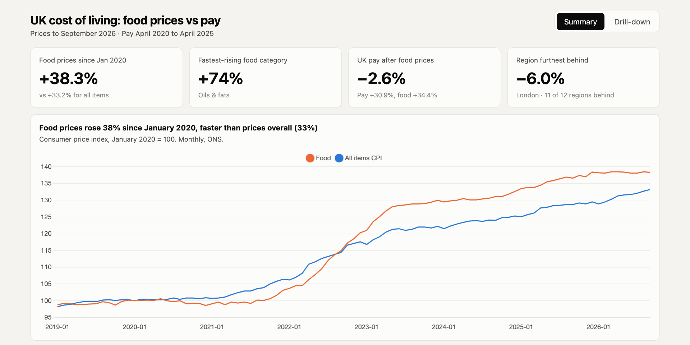
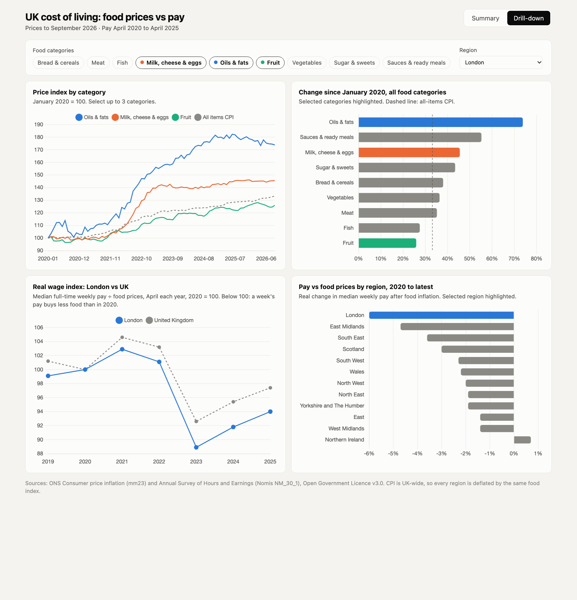

# UK cost-of-living dashboard

**Since January 2020, UK food prices have risen 38%, and in 11 of 12 regions wages haven't kept up.** London fell furthest behind: median full-time pay is up 26% but buys **6% less food** than in 2020.



## Key findings

- **Oils & fats rose fastest, up 74%** since January 2020, nearly double food overall (+38%). Sauces & ready meals (+55%) and milk, cheese & eggs (+46%) come next. Fruit (+26%) and fish (+28%) rose more slowly than prices in general (+33%). **→ Budget support and price-promise schemes get the most out of each pound on staples like oils, dairy and eggs.**
- **Pay lost ground against food in 11 of 12 regions** (April 2020 to April 2025). UK median pay grew 30.9% while food rose 34.4%, so **real pay against food fell 2.6%**. Against *all* prices, pay is up 2.8%. Food is where the squeeze is. **→ Measuring cost of living with headline CPI understates it for households whose budgets are mostly food.**
- **London is weakest (−6.0%) and Northern Ireland the only region ahead (+0.7%).** London's nominal pay growth (26%) was the slowest of any region, from the highest base. **→ "London weighting" pay has eroded the most. That's worth knowing for anyone recruiting or setting pay there.**

Food inflation peaked at **19.6% in March 2023** and was **1.2%** in the year to September 2026.

## Approach

1. **Data:** ONS [Consumer price inflation dataset (mm23)](https://www.ons.gov.uk/economy/inflationandpriceindices/datasets/consumerpriceindices), 9 COICOP food classes plus Food and All items. ONS [ASHE](https://www.ons.gov.uk/employmentandlabourmarket/peopleinwork/earningsandworkinghours) median full-time weekly pay for 12 regions and the UK, 2015–2025 (via Nomis). Both are under the Open Government Licence.
2. **Cleaning (Power Query, [`powerbi/power_query/`](powerbi/power_query/)):** mm23 is 4,000+ series wide with 7 metadata header rows, and annual, quarterly and monthly rows mixed in one column. The query promotes the CDID row to headers, keeps 11 series, filters to monthly rows, unpivots and types them.
3. **Star schema:** `DimDate` (monthly), `DimCategory`, `DimRegion`, `FactPrices`, `FactPay`. ASHE is an April snapshot, so pay joins to April.
4. **DAX ([`powerbi/measures.dax`](powerbi/measures.dax), explained in [`DAX_MEASURES.md`](powerbi/DAX_MEASURES.md)):** year-on-year change, cumulative change since a selectable base year, and a real wage index (pay ÷ April food CPI).
5. **Check:** [`src/build_model.py`](src/build_model.py) rebuilds the same tables and numbers in pandas, so the dashboard figures can be checked without Power BI.

## Results

**Page 2: drill-down by category and region, with slicers**



An interactive HTML preview of both pages is in [`dashboard/`](dashboard/). Run `python -m http.server -d dashboard` and open http://localhost:8000. The Power BI build steps are in [`powerbi/BUILD_GUIDE.md`](powerbi/BUILD_GUIDE.md).

## Limitations and next steps

- CPI is UK-wide (ONS publishes no regional CPI), so regional differences come from pay alone. Housing and energy costs, which do vary by region, are out of scope.
- ASHE medians are for full-time employees by home region. Part-time workers and the self-employed aren't covered, and the 2025 figures are provisional.
- Next: add energy (COICOP 04.5) and rent (ONS PIPR), which would change the regional ranking.

## How to run

```bash
pip install -r requirements.txt
python src/build_model.py      # rebuilds data/model/*.csv, results/, charts/, dashboard/data.js
```
Then build the `.pbix` with [`powerbi/BUILD_GUIDE.md`](powerbi/BUILD_GUIDE.md), or open the HTML preview.
